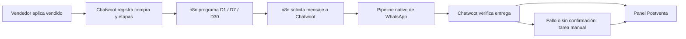

# Postventa Arroyo: n8n envía y Chatwoot verifica

Fecha: 2026-10-13. Rama de trabajo: `arroyo/dev`.
Estado: diseño aprobado por Mauro el 2026-10-13, incluyendo inicio de los cambios. Ejecución en [POST_SALE_IMPLEMENTATION.md](POST_SALE_IMPLEMENTATION.md).

## Objetivo y decisiones confirmadas

N8n debe enviar seguimiento al día siguiente, a los siete días y a los treinta días de la compra, preguntando cómo viene el producto y ofreciendo accesorios. Chatwoot debe mostrar los seguimientos previstos, sus mensajes y resultados, comprobar entrega y generar una tarea manual para Julieta o Marcos cuando el envío falle o no pueda confirmarse.

La fecha base confirmada por Mauro es **el momento en que el vendedor aplica vendido**, corregible si se cargó tarde. No se usará `conversation.created_at`. N8n conserva la programación, elección de texto/plantilla y decisión de cuándo ejecutar el envío. Chatwoot no tendrá un cron que envíe postventa.

La corrección de fecha se propone en el detalle de compra del panel; afectará únicamente etapas todavía no intentadas. El historial de mensajes e intentos existentes no se reescribe.

## Qué existe en n8n y qué falta

Fuente: versión publicada `f334bc60-3ddc-41a5-8b2e-4d69d6c321d2` de [arroyo v3 · seguimientos post-venta](https://n8narroyo.thorque.com.ar/workflow/fF0LK453uWJdBHsR), releída el 13/10. Inventario y contrato core: [N8N_V3_ANALYSIS.md](N8N_V3_ANALYSIS.md).

| Requisito | Estado actual | Trabajo necesario |
|---|---|---|
| Disparar por compra | Busca etiqueta vendido | Registrar fecha de aplicación como compra identificable |
| D+1 | Ofrece accesorios; bicicleta/gimnasio | Revisar texto para incluir consulta sobre el producto y ligar a fecha real |
| D+7 | No existe | Agregar etapa y plantilla |
| D+30 | Service/seguimiento solo zona 3402/341 o zona-local | Convertir a seguimiento de producto y accesorios para clientes elegibles, sin limitarlo a zona |
| Gimnasio D+30 | Plantilla vacía, etapa en pausa | Definir una plantilla válida o una plantilla genérica por producto |
| Fecha base | Creación de conversación | Usar fecha de compra/corrección |
| Entrega | Etiquetas tras intento; diario verifica ID creado | Chatwoot verificará estados reales del mensaje |
| Deduplicación | Marcas de etiquetas/atributos | Identidad por compra y etapa; creación de mensaje idempotente |
| Visibilidad antes de enviar | No declara un plan a Chatwoot | Registrar las tres etapas y fechas previstas |
| Fallo sin mensaje creado | No genera tarea de postventa | Registro previo y control de pendientes vencidos |
| Seguimiento comercial con seguimiento | Rama distinta, tres pasos | Mantener separado de la postventa; corregir escrituras de atributos |

La rama comercial `seguimiento` no es la etapa D+7. Sus plantillas `seg_dia_1/3/5` se eligen por contador y no representan fechas de compra.

## Arquitectura propuesta y alternativas

**Recomendación: API Arroyo de registro y creación de mensaje por etapa.** N8n declara su programación y, al vencer una etapa, llama a Chatwoot con el contenido elegido. Chatwoot crea el mensaje por el pipeline nativo, lo vincula a la etapa en la misma transacción y observa entrega. Esto evita el hueco entre “crear mensaje” y “avisar cuál fue”: un timeout HTTP se reconcilia consultando/reintentando la misma etapa, sin crear otro mensaje.

Alternativa más pequeña: mantener POST nativo de mensajes y agregar `content_attributes.arroyo_kind`, compra y etapa. Permite observar mensajes creados, pero no cubre por sí sola programados, errores antes de crear el mensaje ni deduplicación del POST; exige un registro previo y termina necesitando coordinación similar.

Alternativa de trasladar programación y envío a Rails: no se elige porque contradice el reparto solicitado. Se conservan en Rails únicamente la creación normal de mensajes y la supervisión de resultados.

### Flujo

1. El vendedor aplica `vendido`. Chatwoot registra compra, fecha y vendedor de ese momento, con las tres etapas aún sin fecha programada.
2. N8n consulta compras que requieren programación, calcula D+1/D+7/D+30 y declara las fechas a Chatwoot.
3. El cron de n8n consulta etapas previstas, selecciona las vencidas y elige texto/plantilla.
4. N8n solicita crear el mensaje para esa etapa. Chatwoot registra mensaje, correlación y hora del intento.
5. El pipeline nativo envía a WhatsApp; los webhooks de Meta actualizan el mensaje en Chatwoot.
6. Un listener Arroyo refleja `delivered/read/failed`. El watchdog de Chatwoot detecta falta de confirmación o etapas que n8n no ejecutó.
7. Julieta o Marcos ven la alerta en Postventa, realizan el contacto manual y registran el resultado.

El registro local es la fuente común de identidad y resultados. La programación se calcula en n8n; almacenar sus fechas en Chatwoot permite mostrarlas y supervisarlas, no convierte a Rails en emisor programado.

## Reglas de negocio propuestas

Las siguientes elecciones son propuestas para revisar, no respuestas ya confirmadas por el usuario:

- **Hora:** mantener 10:00 de America/Argentina/Buenos_Aires, todos los días para postventa, como el cron actual. D+1 significa siguiente día calendario local; D+7 y D+30 son 7 y 30 días calendario, no meses variables.
- **Cobertura:** cuentas con integración activa y conversaciones de WhatsApp Cloud elegibles. Aplicar D1/D7/D30 a todos los rubros y zonas; el service local actual no debe quedar conectado como un cuarto mensaje duplicado.
- **Responsable:** vendedor original si es Julieta o Marcos; de lo contrario notificar a los responsables configurados y dejar un responsable de la tarea explícito. Las identidades se eligen por cuenta, no por IDs 4/5 hardcodeados.
- **Producto:** copiar el valor de `producto_comprado` si está cargado, más rubro. Si solo se conoce rubro usar “tu bicicleta”/“tu equipo”; si falta, texto genérico, sin asumir bicicleta.
- **Cancelación:** `venta-cancelada` o retirar `vendido` de la conversación cancela etapas pendientes; `no-contactar` en contacto o conversación también las cancela. No genera tarea invitando a contactar manualmente a una persona excluida. Verificar exclusión nuevamente antes de enviar.
- **Reapertura:** al crear postventa, una conversación resuelta se reabre como `open`; se conserva o restaura un vendedor válido de la cuenta. La respuesta no debe volver al circuito de localidad del bot.
- **Reintentos:** en MVP, una etapa genera como máximo un mensaje automático. Repetir la llamada devuelve el mismo registro; no se reenvía automáticamente un mensaje fallido o sin entrega confirmada.
- **Compras repetidas:** MVP registra una compra por conversación. Quitar y reponer vendido no inventa otra compra ni duplica las etapas; una compra real posterior en la misma conversación requiere definición de UX antes de soportarla.
- **Cambio de fecha:** queda auditado y modifica únicamente pendientes. N8n recalcula y presenta una revisión nueva; una llamada con revisión antigua no puede crear un mensaje. Si la corrección deja etapas antiguas vencidas, se muestran para revisión manual sin envío masivo retroactivo.

## Ventana de Meta y confirmación de entrega

Fuera de las 24 horas desde el último entrante, la plataforma admite plantillas aprobadas. Una ventana cerrada no implica por sí sola fallo de una plantilla. Fuente primaria: [política de WhatsApp Business](https://business.whatsapp.com/policy/preview?lang=es_LA), sección de plataforma.

El servicio de este repo prioriza plantilla siempre que se envía `template_params`, incluso con ventana abierta: [send_on_whatsapp_service.rb](../../app/services/whatsapp/send_on_whatsapp_service.rb). N8n debe elegir explícitamente:
- Texto libre: omitir `template_params`, solo con `can_reply?` abierto.
- Plantilla: incluir parámetros y nombre válido, especialmente con ventana cerrada.

Se propone empezar con **tres plantillas genéricas**, una por etapa, con variables de asesor y producto. Como incluyen oferta de accesorios, se preparan para revisión de Meta como Marketing. Las plantillas aprobadas y sus variables deben verificarse antes de activar; no se presume aprobación por existir un nombre en configuración.

| Estado visible | Qué acredita | Acción |
|---|---|---|
| Por programar | Compra registrada, n8n aún no declaró fechas | Visible; alertar si vence el plazo de programación |
| Programado | Fecha declarada por n8n | Esperar solicitud de envío |
| En proceso | Mensaje creado, envío/confirmación pendiente | Mostrar mensaje, no llamarlo entregado |
| Enviado | Evidencia de aceptación por proveedor/source_id | Esperar entrega |
| Entregado | Status delivered | Seguimiento automático logrado |
| Leído | Status read | Seguimiento automático logrado |
| Fallido | Fallo local o status failed | Alerta inmediata con causa disponible |
| Entrega no confirmada | Venció plazo sin delivered/read | Tarea manual; no afirmar bloqueo ni ventana cerrada |
| Cancelado | Exclusión/cancelación del seguimiento | Conservar historial |
| No ejecutado | Venció programación sin mensaje | Tarea manual por fallo de programación/integración |

El status core `sent` es predeterminado al crear el mensaje; no basta para distinguir “en proceso” de “enviado”. Fuente: [message.rb](../../app/models/message.rb). Para enviados se combinará el status con la evidencia de `source_id`. Una respuesta HTTP con ID acredita solo creación local.

Listener Rails sobre `message_updated`, con vínculo por **message_id**, sin depender del último mensaje anidado en webhooks. Eventos duplicados o fuera de orden no deben duplicar alertas ni hacer retroceder delivered/read. Lectura del status actual y reconciliación tras persistir el vínculo para cubrir actualizaciones rápidas.

Propuesta de watchdog: cada **30 minutos**, plazo inicial **6 horas** desde intento para falta de entrega y desde fecha prevista para no ejecución. Para compras sin programación: seis horas desde la primera hora prevista D+1, calculada únicamente como límite de supervisión. Estos valores son configurables; son una política operativa, no una regla de Meta.

Error con código/causa explícita de ventana cerrada: mostrarlo como tal. Error sin código: preservar el texto, sin asignar una causa inventada. Falta de plantilla, rechazo, problemas de canal y otros fallos también deben ser visibles. Una entrega tardía actualiza el resultado y cierra automáticamente una tarea todavía pendiente, dejando constancia; si ya fue resuelta manualmente conserva esa resolución.

## Datos y contrato entre sistemas

Propuesta de dos tablas, sin modificar tablas ni migraciones existentes:

- `arroyo_post_sale_purchases`: cuenta, conversación, contacto/inbox, referencia estable de compra, fecha efectiva, instante de aplicación vendido, vendedor original, producto/rubro, revisión de programación y auditoría de corrección.
- `arroyo_follow_ups`: compra, etapa d1/d7/d30, fecha prevista, estado de entrega, message_id, fecha de intento, execution_id de n8n, canal/template, error_code/error_message, delivered_at/read_at, destinatarios y responsable de alerta, fecha/resolución manual.

Unicidad por compra/etapa y message_id; vínculo a cuenta derivado del registro, no aceptado ciegamente del payload. Separar estado de entrega de estado de tarea manual: resolver una llamada no convierte un mensaje failed en delivered. Un intento previo sin mensaje conserva su error y no crea un envío nuevo por reintento HTTP. MVP no incorpora reenvíos automáticos ni una tabla adicional de intentos.

Rutas propuestas bajo `/api/v1/accounts/:account_id/arroyo/post_sale`:
- GET purchases: n8n lee compras activas y revisiones que requieren programación.
- PUT purchases/:reference/plan: declara las tres fechas y revisión; operación idempotente.
- GET follow_ups: n8n consulta previstos/resultados; el panel consulta con permisos por vendedor.
- POST follow_ups/:id/message: crea o devuelve el mensaje de la etapa, con bloqueo de fila y revisión vigente.
- PATCH purchases/:reference: corrige fecha por usuario autorizado y registra auditoría.
- POST follow_ups/:id/resolve: resultado manual y nota.

En el endpoint de mensaje: autenticar n8n con el mecanismo nativo de **usuario autorizado de la cuenta**, sin secretos en JSON ni documentos. Los tokens de AgentBot actuales no tienen acceso general a endpoints Arroyo, por lo que no se debe asumir que funcionarán sin ampliar core. Evitar esa ampliación en MVP. Crear el mensaje con emisor de sistema (`sender: nil`) y `arroyo_kind: post_sale`, referencias de compra/etapa. Esto impide contarlo como actividad humana y mantiene el historial visible.

N8n declara textos y parámetros; Chatwoot realiza creación/vínculo por el pipeline habitual. Un timeout HTTP se resuelve consultando/reintentando esta ruta idempotente; nunca enviando otro POST directo al endpoint nativo como fallback.

N8n no usa los marcadores históricos como prueba de entrega: el estado del registro local es el resultado vigente. Si hay una nueva compra de postventa activa registrada, la rama diaria evita mandar un seguimiento comercial sobre esa misma compra; se aplica a la nueva integración, sin reclasificar automáticamente todo el histórico con vendido.

## Panel de vendedores: pestaña Postventa

Integrar en el panel actual, reutilizando sus componentes, filtros y permisos.

- Resumen: programados, en proceso/enviados, entregados/leídos, fallidos, sin confirmación y tareas manuales pendientes.
- Listado: cliente, producto/rubro, vendedor original, etapa, fecha prevista/real, estado, motivo y responsable.
- Detalle: compra y sus tres etapas, contenido/template, vínculo al mensaje/conversación, error y fechas.
- Alertas visibles en la pestaña y nota privada con mención al responsable. La tarea permanece hasta resolución o entrega tardía comprobada.
- Acción “Registrar seguimiento manual”: llamada / WhatsApp personal / otro, resultado y nota. Registra lo informado; no simula ni envía esos contactos.
- Agente: sus compras y las tareas asignadas a él. Administrador: toda la cuenta. No cambiar asignación de la conversación solo por crear una alerta.
- `seguimiento-manual` se mantiene mientras exista al menos una tarea pendiente en esa conversación.
- Copias en es/en, Tailwind y componentes-next. Sin mockup ni componentes nuevos en esta etapa de planificación.

## Correcciones incorporadas y prioridades

**Parte necesaria de esta integración:** fecha real, D7, D30 sin exclusión por zona, registro por etapa, unicidad/HTTP idempotente, distinción creación/entrega, ventana vs fallo real, emisor sistema, cancelaciones, reapertura y permiso por responsable.

**Corrección previa de n8n que toca el mismo workflow:** preservar atributos ajenos en `Marcar Envio Del Dia`/`Resetear Contador`. Un GET+merge reduce pérdida accidental pero no garantiza concurrencia; para corregirla se propone endpoint Arroyo de merge bajo bloqueo que admita solamente claves `seguimiento_*`. No cambiar la semántica del endpoint core. Las etiquetas deberán leerse/actualizarse preservando ajenas; las nuevas alertas usan adición/remoción en Rails bajo bloqueo de conversación.

**A verificar durante puesta en marcha:** tipo real de sender de la rama diaria heredada, pues no se pudo inferir la identidad de credenciales desde definiciones sanitizadas. Su exclusión de métricas no se garantiza hasta comprobarlo. La nueva postventa quedará explícitamente excluida con emisor de sistema.

**Fuera de esta entrega:** corregir contador global de turnos `rr:counter`, construir Window Keeper, cambiar bot v3, email marketing y trasladar la rama comercial diaria a Rails. Quedan documentados; la secuencia comercial actual mantiene sus reglas salvo preservación de datos y coordinación para evitar postventa y seguimiento simultáneos de una venta.

## Configuración y cambios previstos en el fork

`post_sale.enabled` permanece apagado por defecto. Gobierna admisión/planificación/envíos por la nueva integración, sin crear un emisor Rails. N8n debe leer el estado y detenerse ante desactivación; rechazar nuevos envíos en backend también. Seguir reconciliando mensajes ya creados y tareas existentes, para no perder resultados al apagar el flag.

Para activar, configurar Julieta/Marcos como responsables válidos de la cuenta y administradores o miembros de los inboxes correspondientes, y habilitar el panel. Propuesta de alertas MVP: tarea del panel y mención nativa, respetando preferencias de notificación existentes; no sumar un segundo mailer que duplique correos. Ajustar la configuración actual para que los controles visibles correspondan a esta implementación.

Revisar la pantalla actual: días, hora, textos y plantillas hoy parecen gobernar Rails aunque no tienen ejecución. En este diseño esos datos los consume n8n; el panel/configuración debe aclararlo. Mantener una única fuente efectiva de configuración, sin valores distintos en n8n y Rails. N8n calcula las fechas y consulta la configuración declarada en la cuenta.

Nuevos archivos en namespace Arroyo: modelos, services de compras/planes/mensajes/estados/alertas, controllers y policies, listeners y watchdog job; UI bajo `routes/dashboard/arroyo/panel`; specs bajo `spec/**/arroyo` y specs frontend correspondientes.

Hooks core propuestos y limitados:
- `app/dispatchers/sync_dispatcher.rb`: listener de compra pequeño para capturar fecha/asignado al aplicar vendido, sin red ni envío. Se propone síncrono porque el evento async recarga el registro y podría perder el vendedor del momento.
- `app/dispatchers/async_dispatcher.rb`: listener de estados del mensaje.
- `config/schedule.yml`: watchdog, nunca dispatch de postventa.
- `config/routes.rb` solo si hace falta ampliar el montaje existente; preferir `config/routes/arroyo.rb`.
- Cada modificación core marcada `ARROYO:`. No editar enterprise ni migraciones existentes.

Estos hooks amplían lo previsto en la Fase 3 original: se registran aquí para revisión antes de implementarlos. Verificar comportamiento EE heredado con los specs afectados, sin modificar enterprise.

## Secuencia de trabajo propuesta

1. Confirmar propuesta y política de horarios/responsables; reemplazar formalmente la Fase 3 original por este reparto.
2. Implementar registro de compra/etapas y contrato idempotente; incluir configuración/permisos y cancelaciones.
3. Implementar listener de entrega, watchdog, tareas manuales y resolución; validar fallos locales y posteriores.
4. Integrar pestaña Postventa al panel con fechas, estados y resolución.
5. Preparar cambios de n8n en borrador: registro/programación D1/D7/D30, mensajes por API Arroyo, preservación de atributos y plantillas verificadas.
6. Probar en staging con número propio; coordinar corte de la antigua rama de postventa, sin activar dos emisores. Activar por cuenta después de validar.
7. Reconciliar legado únicamente con identificación de mensajes existentes o revisión manual; no inventar entrega ni lanzar etapas vencidas en bloque.

No actualizar/publicar workflows, modificar Meta ni desplegar durante la planificación. La activación debe ser el último paso después de revisión de cambios y pruebas.

## Criterios de aceptación

- Aplicar vendido el 13/10 crea una compra con ese momento y un vendedor original; n8n programa 14/10, 20/10 y 12/11 en zona local.
- Conversación antigua vendida hoy usa hoy; corrección posterior no altera mensajes ya enviados.
- Repetir la etiqueta/evento, plan o llamada HTTP no duplica etapas ni mensajes.
- Un mensaje creado no aparece entregado antes de delivered/read, aunque tenga status core sent.
- Error de ventana genera tarea para responsable con motivo; plantilla entregada fuera de ventana no genera alerta.
- Fallo inmediato antes de crear mensaje y fallo posterior de Meta quedan visibles.
- Falta de confirmación a seis horas y n8n que no ejecuta una etapa generan tareas distintas.
- Eventos duplicados/fuera de orden y entrega tardía no duplican tareas ni borran historial manual.
- Resolver manualmente conserva error original y no resuelve la conversación.
- No-contactar/venta cancelada cancela pendientes sin invitar a seguimiento manual.
- Conversación resuelta se abre antes de postventa; entrante posterior llega al vendedor.
- Agente no accede a compras/tareas de otro vendedor salvo tarea asignada; datos de otra cuenta no cruzan.
- Nueva postventa no suma mensajes humanos al panel; escritura de contadores preserva atributos ajenos.
- Corte de n8n legado no repite D1/D30 previos; la rama comercial sigue funcionando.
- Specs nuevos y core afectados, RuboCop/ESLint en tocados y comprobación de UI/staging. Estado actual y límites de verificación: [POST_SALE_RUNBOOK.md](POST_SALE_RUNBOOK.md).

## Fuentes

- [N8N_V3_ANALYSIS.md](N8N_V3_ANALYSIS.md), relevamiento completo.
- [PLAN.md](PLAN.md), Fases 3 y 4 originales, sujetas a esta revisión.
- [Arroyo::Setting](../../app/models/arroyo/setting.rb), configuración actual.
- [SyncDispatcher](../../app/dispatchers/sync_dispatcher.rb) y [AsyncDispatcher](../../app/dispatchers/async_dispatcher.rb), puntos de registro.
- [AccessTokenAuthHelper](../../app/controllers/concerns/access_token_auth_helper.rb), acceso restringido de bots.
- [MessageBuilder](../../app/builders/messages/message_builder.rb), creación y sender.
- [WhatsApp status](../../app/services/whatsapp/incoming_message_base_service.rb), actualización por source_id.
- [Panel actual](../../app/javascript/dashboard/routes/dashboard/arroyo/panel/Index.vue), pestañas existentes.
